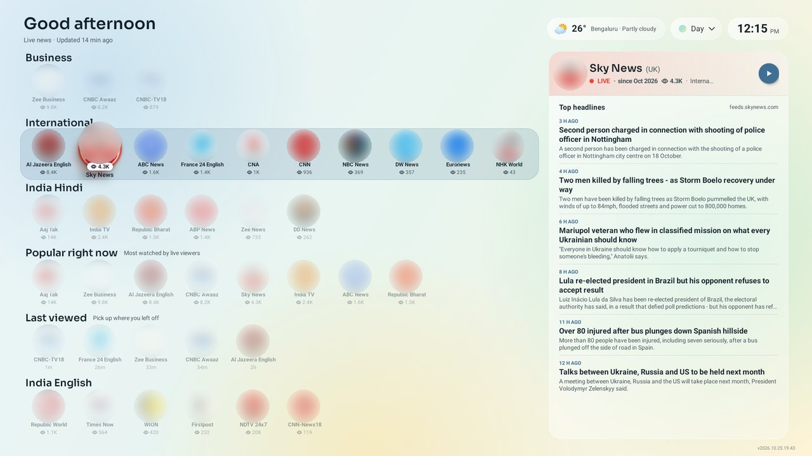
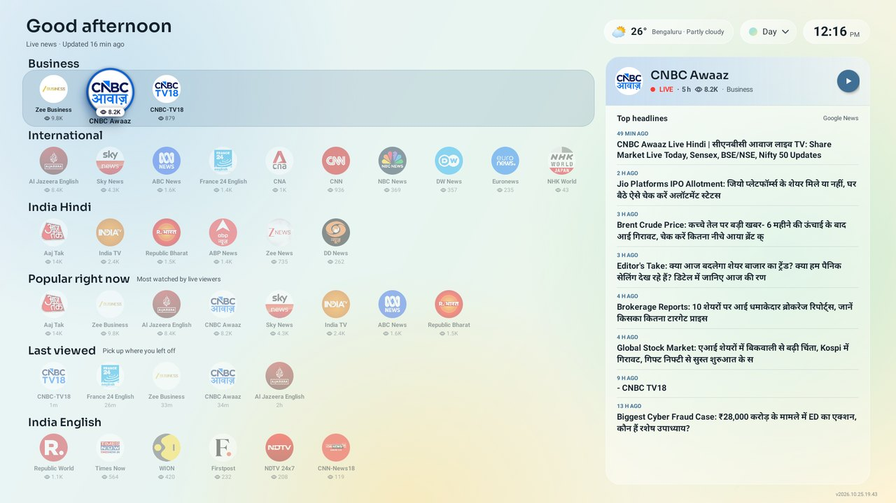
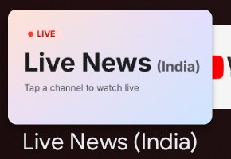
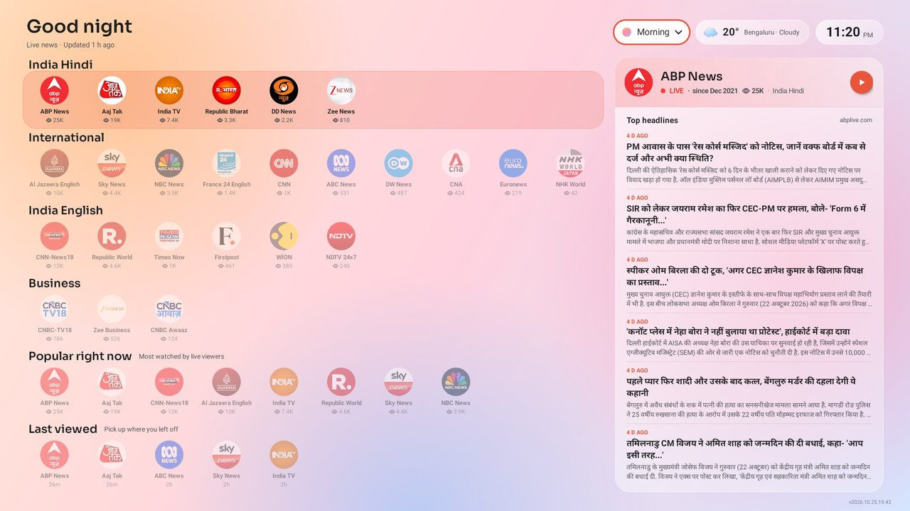
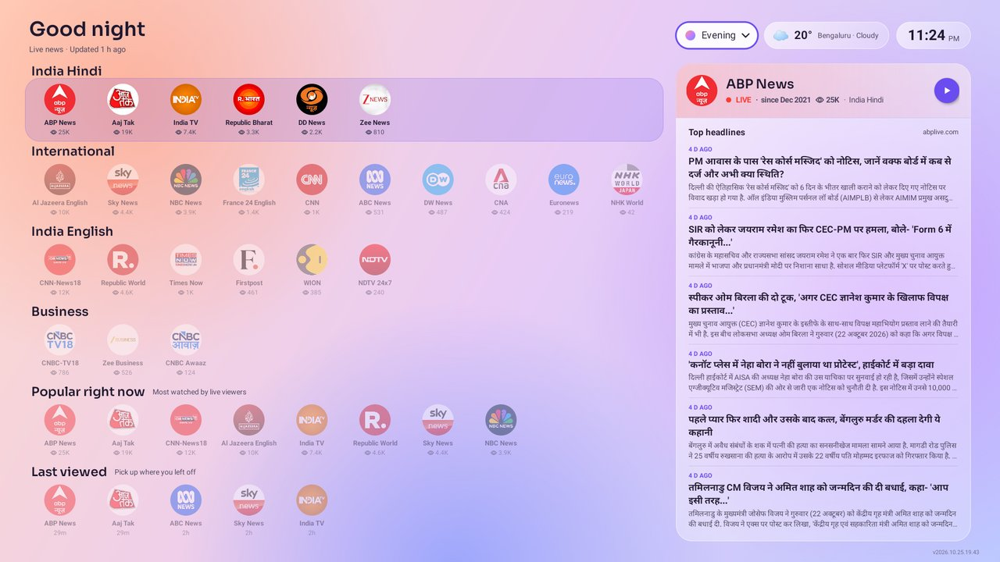
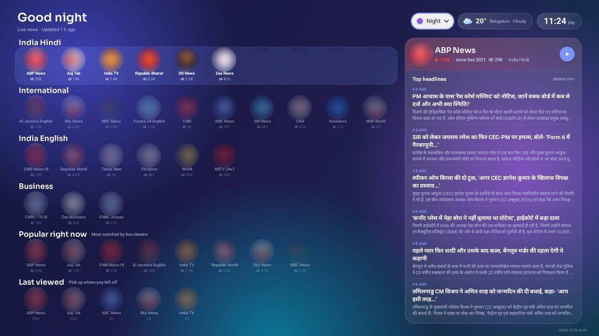
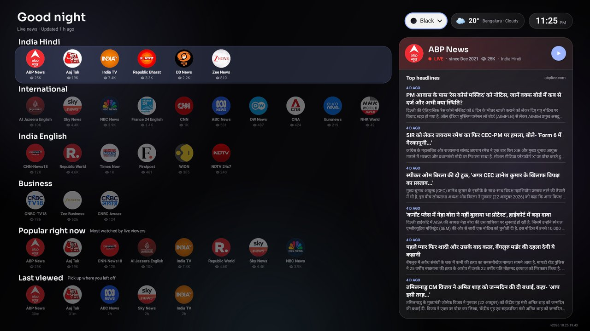
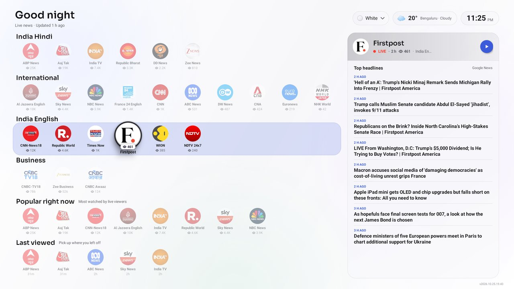
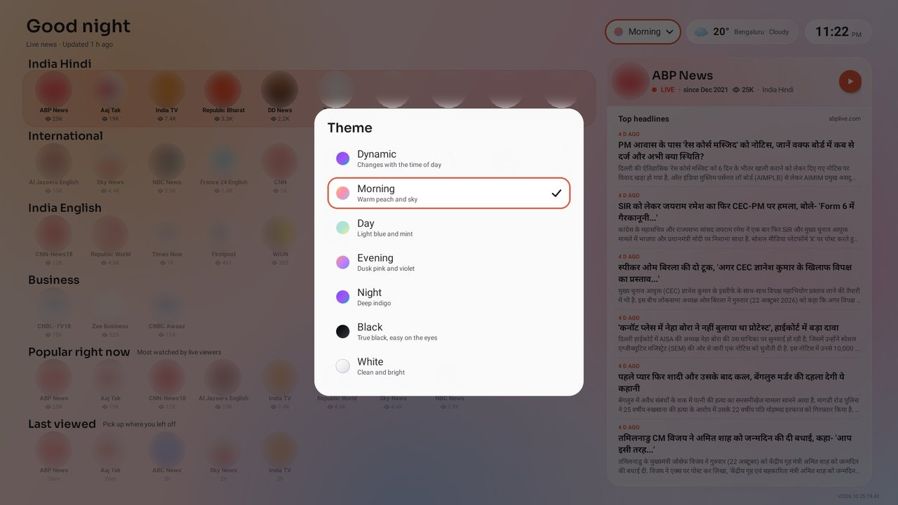
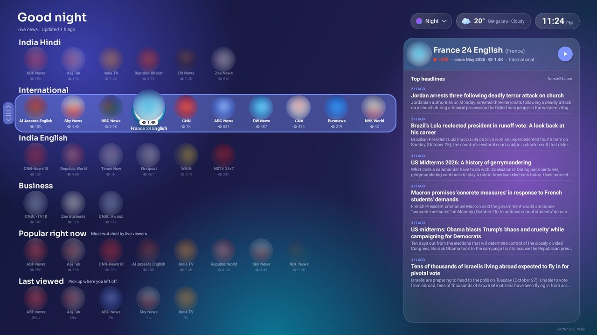

# Live News (India)

An Android TV app that puts 25 Indian and world live news channels on one screen. Pick a
logo, press OK, and the live stream opens in the YouTube TV app. Next to the picker are the
viewer count, how long the stream has been live, top headlines and the weather.



## The problem

Finding the right live stream for a news channel is hard, and sometimes impossible. One channel
often has several live streams running at once, and all of them call themselves the live stream.
Some are the real 24x7 feed and others are programme streams. This app
works out which one is the main stream, keeps it up to date automatically, and opens it directly
from one screen of channel logos.

## What it does

- Logo-only picker in rows: Popular right now, Last viewed, India Hindi, India English, Business, International
- Live viewer count and "live for" time on each channel, headlines and weather
- Seven themes: dynamic (follows the clock), morning, day, evening, night, black, white
- Hold OK on a row to move it up or down, and the order is remembered
- Opens the stream in the YouTube TV app, and tells you if that app is missing, the TV is offline, or the channel is not live

A Hindi business channel with its own headlines, and the app's tile on the Android TV home row:

| Home screen | Launcher tile |
|---|---|
|  |  |

## Themes and reordering

Seven themes: dynamic (follows the clock), morning, day, evening, night, black and white.
The theme pill at the top right opens the picker. Hold OK on a row to move it up or down, and the
order is remembered.

| Morning | Evening |
|---|---|
|  |  |
| **Night** | **Black** |
|  |  |
| **White** | **Choosing a theme** |
|  |  |

Moving a row (the arrows at the left edge show the row is being moved):



## Built for real use

This is meant to run on a living-room TV every day, so the small things are handled.

| Area | What was done |
|---|---|
| Stream links are never fixed | A scheduled job re-checks every channel each hour. When a channel has several live streams it keeps those with at least 20 percent of the top viewer count (at most 4), picks the oldest, and falls back to the most viewed. Manual overrides are possible. |
| Viewer counts and headlines are live | Counts, start times and headlines are refreshed on a schedule, not typed in. |
| App updates its own list | The TV checks the feed at most every 5 minutes. Only a changed list is downloaded (ETag), icons are fetched first, and the file is written atomically. |
| Failures do not break the screen | If a download fails, the list already on the TV stays in use. A list older than 3 hours shows a warning. |
| Edge cases | YouTube TV not installed, no internet, a channel not live, and no headlines available all have their own message. |
| Small and light | 0.25 MB release APK (2.9 MB debug build), no third-party libraries, 33 MB of memory at start. |
| Memory tested | 500 automated reorders on a 2 GB TV with a flat memory trend, see below. |
| Low server cost | Cloudflare Workers KV with a 60 second edge cache, writes batched to stay inside the free plan. |

## Measured

Xiaomi Mi Box 4, 26 Oct 2026, debug build. Details and method in [docs/performance.md](docs/performance.md).

| Measure | Result |
|---|---|
| APK size | 0.25 MB release, 2.9 MB debug |
| Third-party libraries | 0 |
| Memory at fresh start | 33 MB |
| Memory during 500 reorders | median 60 MB, peak 72 MB, flat trend |
| TV memory in use | 56 to 58 percent of 1,987 MB |
| Channels | 25 |
| Android | min SDK 28, target SDK 37 |

## How it works

1. A scheduled collector finds the live stream for each channel and reads headlines and weather.
2. It writes `channels.json` and the logos to Cloudflare Workers KV.
3. A small Worker (in `cloudflare/`) serves them at a public address, with ETag and a short cache.
4. The app downloads them into its own folder and draws the screen from that file only.
5. OK on a channel opens the stream in the YouTube TV app.

The app never knows how the file was made, so you can also write `channels.json` by hand and push
it with adb. The collector itself is kept in a separate private repository. This repository has
everything needed to build the app and serve your own feed. See [docs/feed.md](docs/feed.md).

## Download

The [releases page](https://github.com/nishantkumarsinha/live-news-tv/releases/latest) has a developer build. It is not a ready to use app. The author's feed is private, so you need your own feed, see [docs/feed.md](docs/feed.md).

## Build and install

Full steps are in [docs/INSTALL.md](docs/INSTALL.md). In short:

```
./gradlew assembleProdDebug
adb connect <tv-ip>:5555
adb install -r app/build/outputs/apk/prod/debug/app-prod-debug.apk
```

The author's feed is private and only answers the author's own builds. To run the app, use your
own feed: change one line in `app/build.gradle.kts` or push the files with adb. Both routes are
explained in [docs/feed.md](docs/feed.md).

## Repository layout

| Path | Contents |
|---|---|
| `app/` | The Android app (Kotlin, two source files, no libraries) |
| `cloudflare/` | The feed Worker and a placeholder `wrangler.toml` |
| `docs/` | Install guide, feed guide, performance notes, sample `channels.json`, screenshots |
| `NOTICE.md`, `licenses/` | Font, data and trademark notices, and the font licence text |
| `.githooks/` | Optional pre-commit check, turn on with `git config core.hooksPath .githooks` |

## Licence

MIT, see [LICENSE](LICENSE). Third-party notices are in [NOTICE.md](NOTICE.md).
This project is not affiliated with YouTube, Google or any news channel.
